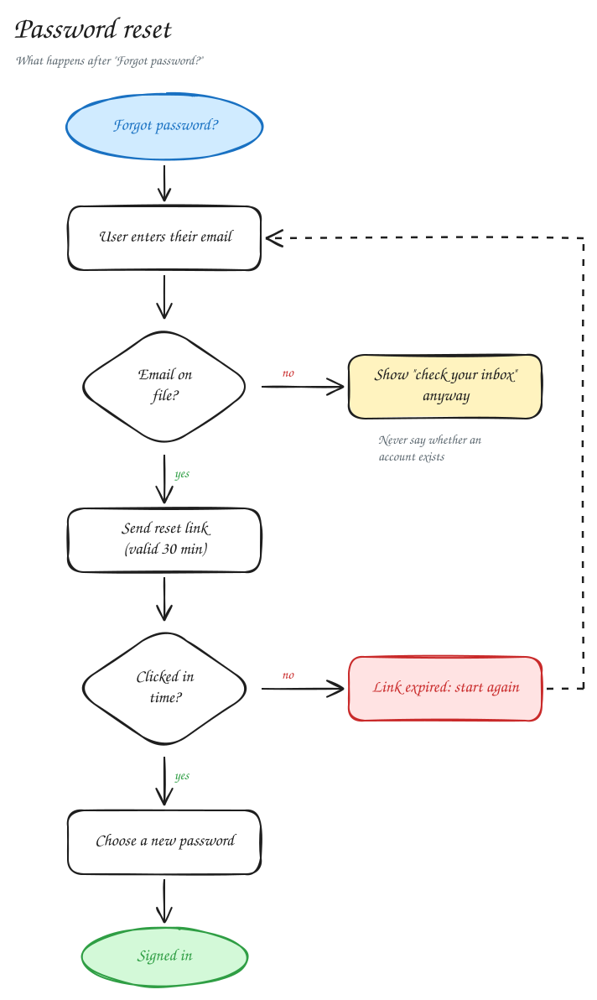
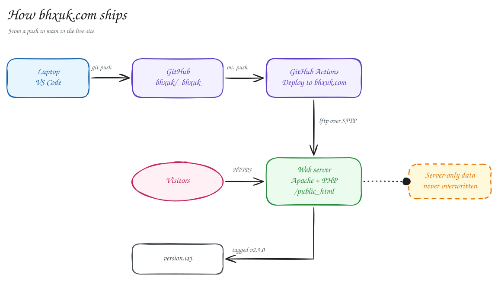
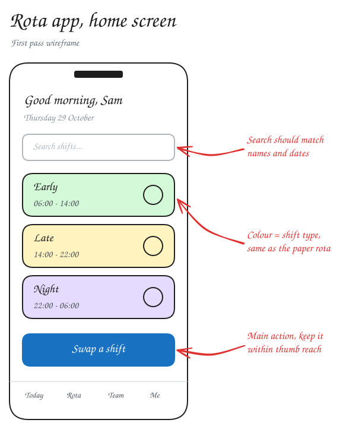
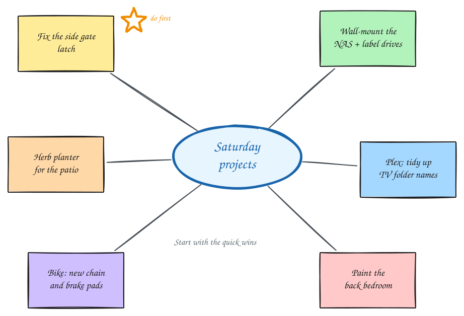

# Sketchpad

A hand-drawn style whiteboard that runs entirely in the browser. Sketch diagrams, flowcharts and ideas, then export them as PNG or SVG.

Sketchpad reads and writes the `.excalidraw` file format, so drawings move freely between Sketchpad and [Excalidraw](https://excalidraw.com).

No build step, no server code, no Docker. It is plain HTML, CSS and JavaScript.

**Use it:** [bhxuk.com/sketchpad](https://bhxuk.com/sketchpad/) · **Guide and examples:** [bhxuk.com/sketchpad/about](https://bhxuk.com/sketchpad/about/)

## Examples

Click one to open it in Sketchpad, ready to edit. The files are in [`examples/`](examples/).

| | |
|---|---|
| [](https://bhxuk.com/sketchpad/#example=flowchart) | [](https://bhxuk.com/sketchpad/#example=architecture) |
| **Flowchart:** decisions, colour-coded outcomes, a dashed loop | **Deployment diagram:** fills, bent arrows, dotted connectors |
| [](https://bhxuk.com/sketchpad/#example=wireframe) | [](https://bhxuk.com/sketchpad/#example=brainstorm) |
| **Wireframe:** clean architect lines with red callouts | **Brainstorm:** sticky notes, connectors and a freehand star |

Any copy of Sketchpad opens a bundled example with `#example=<name>` on the end of its address.

## Running it

- **Locally:** open `index.html` in a browser. That's it.
- **On a web server:** upload the whole folder (for example to `/public_html/sketchpad/` over SFTP). Any static host works, Apache included.
- **GitHub Pages:** Settings → Pages → Deploy from branch → `main` / root for the app, or `main` / `docs` for the landing page.

Drawings save automatically in the browser's local storage, so a refresh never loses work. Use **Save to file** for anything you want to keep long term or move between machines.

## Features

**Drawing**
- Rectangle, diamond, ellipse, arrow, line, freehand pencil, text and images
- Hand-drawn rendering via rough.js, with three sloppiness levels from neat to cartoon
- Stroke and background colours (quick swatches, colour picker or hex), hachure / cross-hatch / solid / zigzag fills
- Stroke width, solid / dashed / dotted strokes, sharp or round corners, straight or curved lines
- Arrowheads at either end: arrow, triangle, dot, bar
- Hand-drawn, normal and code fonts in four sizes, left / centre / right aligned
- Opacity for any element
- Multi-point lines (click, click, Enter) and closed shapes (click the first point again)
- Laser pointer for presenting

**Connecting**
- Arrows snap onto shapes, images and text, and stay attached when you move or resize them
- Double-click any shape to type a label inside it. The label wraps, centres and rotates with the shape

**Editing**
- Select, shift-click, or drag a box to select several
- Move, resize from any edge or corner, rotate (Shift for 15° steps)
- Edit line points directly, drag a midpoint to bend a line, drop a point onto its neighbour to remove it
- Group and ungroup, bring forward and send back, align and distribute
- Duplicate (Ctrl+D or Alt+drag), copy and paste (also between browser tabs and into Excalidraw), copy and paste styles
- Lock elements so they can't be moved by accident
- Eraser
- Unlimited undo and redo within a session

**Canvas**
- Infinite canvas with scroll to pan, Ctrl+scroll or pinch to zoom
- Optional grid with snapping
- Light and dark mode, five canvas background colours
- Zoom to fit, zoom to selection, scroll back to content

**Files and sharing**
- Open and save `.excalidraw` / `.json` files (in Chrome and Edge, Ctrl+S saves back to the same file)
- Drag and drop drawings or images onto the canvas, or paste images straight from the clipboard
- Export PNG (1×, 2×, 3×, with or without background, light or dark) and SVG with the handwriting font embedded
- Copy the drawing as an image to the clipboard
- **Share links:** the whole drawing is compressed into the link itself, so nothing is uploaded anywhere. Images are left out of links to keep them short
- Personal library: save any selection, click to reuse it later, and import `.excalidrawlib` files

## Shortcuts

Press `?` in the app for the full list.

| Tool | Key | | Action | Key |
|---|---|---|---|---|
| Hand | `H` or hold `Space` | | Undo / redo | `Ctrl+Z` / `Ctrl+Shift+Z` |
| Selection | `V` `1` | | Duplicate | `Ctrl+D` |
| Rectangle | `R` `2` | | Group / ungroup | `Ctrl+G` / `Ctrl+Shift+G` |
| Diamond | `D` `3` | | Bring forward / to front | `Ctrl+]` / `Ctrl+Shift+]` |
| Ellipse | `O` `4` | | Send backward / to back | `Ctrl+[` / `Ctrl+Shift+[` |
| Arrow | `A` `5` | | Zoom to fit | `Shift+1` |
| Line | `L` `6` | | Grid | `Ctrl+'` |
| Draw | `P` `7` | | Dark mode | `Alt+Shift+D` |
| Text | `T` `8` | | Save / open | `Ctrl+S` / `Ctrl+O` |
| Image | `9` | | Export image | `Ctrl+Shift+E` |
| Eraser | `E` `0` | | Keep tool selected | `Q` |
| Laser | `K` | | | |

## Project layout

```
index.html        the app: page shell, menus and dialogs
css/app.css       all styling, light and dark themes
js/core.js        element model, geometry, hit testing, rendering, import and export
js/app.js         state, tools, mouse/touch/keyboard input, history, panels
js/icons.js       line icons
vendor/rough.js   rough.js 4.6.6 (MIT), the hand-drawn renderer
fonts/            Kalam handwriting font (SIL Open Font License)
examples/         example drawings, opened with #example=<name>
docs/             landing page (served at bhxuk.com/sketchpad/about/, or GitHub Pages from /docs)
```

## Publishing to bhxuk.com

The live copy lives in the `bhxuk/_bhxuk` repo under `public_html/sketchpad/`, with `docs/` copied to `public_html/sketchpad/about/`. Pushing that repo deploys it. When you change CSS or JS here, bump the `?v=` number on the links in `index.html` so browsers pick up the new files.

The browser console exposes `window.sketchpad` (state, history and a few helpers) for debugging.

## What it doesn't do (yet)

- Live collaboration. That needs a small relay server; the share links cover one-way sharing for now
- Frames, embeds and elbow arrows from newer Excalidraw files. Frames are skipped on import and elbow arrows open as straight arrows
- Pressure-sensitive pencil strokes

## Credits

Inspired by Excalidraw. Rendering by [rough.js](https://roughjs.com). Handwriting font: [Kalam](https://fonts.google.com/specimen/Kalam) by the Indian Type Foundry. Licences for both are in `vendor/` and `fonts/`.
